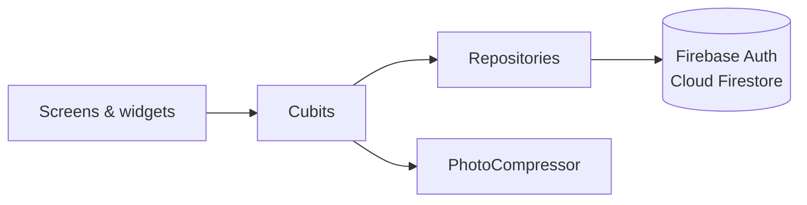
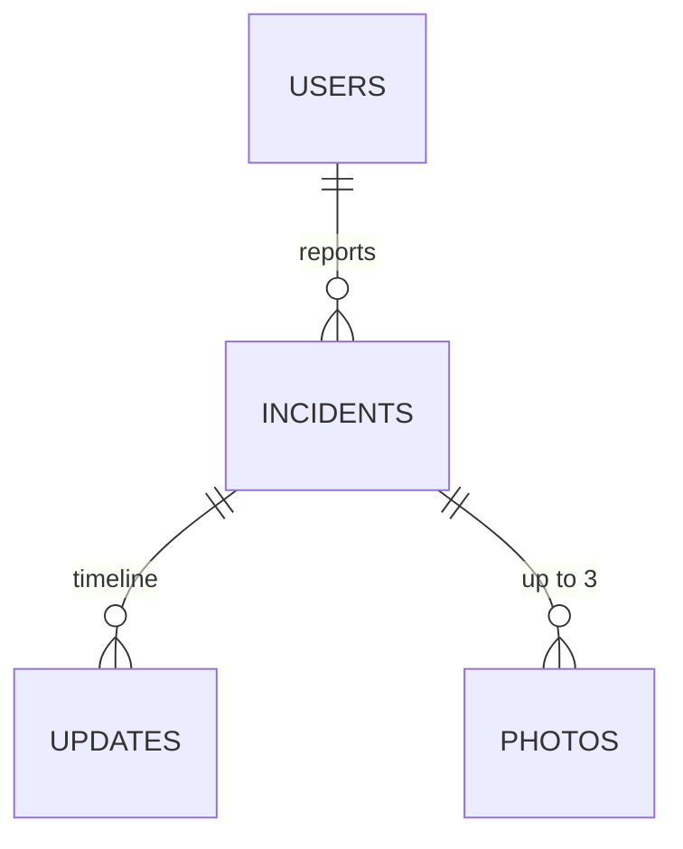

# Campus Incident Reporter

**Individual Assignment 2: Campus Incident Reporting App**

A Flutter mobile app for African Leadership University (ALU) where **students report campus problems** (a leaking tap, a broken projector, exposed wiring) and **staff review, prioritise and resolve them**, with every status change recorded on a timeline the student can follow.

Built with **Flutter**, **BLoC/Cubit** for state management and **Firebase** (Authentication and Cloud Firestore). The whole app runs on Firebase's **free Spark plan**.

---

## Contents

1. [The problem](#1-the-problem)
2. [Features](#2-features)
3. [Screens](#3-screens)
4. [Tech stack](#4-tech-stack)
5. [Architecture](#5-architecture)
6. [Data model](#6-data-model)
7. [Roles, authentication and access control](#7-roles-authentication-and-access-control)
8. [Security rules](#8-security-rules)
9. [Design decisions](#9-design-decisions)
10. [Getting started](#10-getting-started)
11. [Testing](#11-testing)
12. [Known limitations](#12-known-limitations)
13. [Troubleshooting](#13-troubleshooting)
14. [Credits](#14-credits)

---

## 1. The problem

On campus, issues are usually reported by word of mouth or scattered messages. Reports get lost, the same problem is reported several times, and students never find out whether anything was done.

This app gives the campus one place to:

- **Report** an issue in under a minute, with a category, location and photos.
- **Track** it through clear statuses (Submitted → In Progress → Resolved, or Rejected), each change explained by a staff note.
- **Avoid duplicates**: students who see an existing report tap **"Me too"** instead of filing another, which also tells staff how many people are affected.
- **Report safely**: safety concerns can be submitted **anonymously**.
- **Triage** as staff: see everything waiting, sort by urgency or by how many students are affected, and update the reporter in one step.

---

## 2. Features

### For students

- **ALU-only sign-up.** Only `@alustudent.com` and `@alueducation.com` emails can register; students must **verify their email** before they can use the app.
- **Login** with *Remember me* (keeps you signed in and pre-fills your email) and *Forgot password* (reset by email).
- **Home dashboard**: greeting, a *Report an Issue* card with one-tap **category shortcuts**, a summary with your **resolution rate** and a breakdown by status, and your most recent reports.
- **Report an incident**: choose a category, add a title and description, pick a location, attach **up to 3 photos** (camera or gallery, compressed automatically), and optionally **report anonymously**.
- **My Reports**: your profile card, counts, status tabs, search (title, location or description) and a category filter.
- **Incident details**: status, a visual **status timeline**, the full history with **staff notes**, the description and photos (tap for a zoomable full-screen viewer).
- **"Me too"** on other students' reports.
- **Withdraw** your own report while it is still *Submitted*.
- **Notifications**: a bell with an unread count, a list of status changes with the staff note, and a **live alert** the moment staff update one of your reports.
- **Profile**: details, **profile photo** (take, choose or remove) and log out.

### For staff

- **Staff Dashboard** with an overview of *Waiting*, *In progress*, *Resolved* and *Urgent* (open, high-priority) reports; tap a figure to filter.
- **Search**, **status tabs** with counts, and a **Filters** sheet (sort by newest, most "me too" or highest priority; filter by category).
- **Update status** sheet: new status, priority and a **required note** that appears on the student's timeline.
- **Live alert** whenever a student submits a new report, plus a bell counting reports since staff last checked.
- **Delete** spam or duplicate reports.

### Quality-of-life

- **Offline support**: reports saved without a connection show a **"Pending sync"** badge until they reach the server.
- Pull-to-refresh, shimmer loading placeholders, clear empty and error states, frosted-glass styling, smooth page transitions and press feedback.

---

## 3. Screens

| Screen | Who | Purpose |
|---|---|---|
| Splash | Everyone | Shown while the app checks whether someone is signed in |
| Login / Register | Signed out | ALU email and password; register adds name, program and campus |
| Check your inbox | Unverified students | Explains verification, resends the email, moves on automatically once verified |
| Home | Students | Summary, quick report shortcuts, recent reports |
| Report an Incident | Students | The report form |
| My Reports | Students | All of the student's reports with search and filters |
| Incident Details | Both | Status, timeline, notes, photos; "Me too", delete, and (staff) *Update status* |
| Notifications | Students | Status changes made by staff |
| Staff Dashboard | Staff | Overview, search, filters and the report queue |
| Profile | Both | Account details, profile photo, log out |

---

## 4. Tech stack

| Concern | Package | Version |
|---|---|---|
| State management | `flutter_bloc`, `equatable` | 9.1, 3.0 |
| Backend | `firebase_core`, `firebase_auth`, `cloud_firestore` | 5.0, 7.0, 7.0 |
| Navigation | `go_router` (redirects by auth state and role) | 18.1 |
| Photos | `image_picker`, `flutter_image_compress` | 1.2, 2.5 |
| Local preferences | `shared_preferences` ("Remember me") | 2.5 |
| UI | `shimmer`; Plus Jakarta Sans font (bundled) | 4.0 |
| Dates | `intl` ("2 hours ago", "Oct 15, 10:24 AM") | 0.20 |
| Testing | `flutter_test`, `bloc_test`, `mocktail` | n/a |

Flutter 3.47 / Dart 3.13. Targets **Android** and **iOS**.

---

## 5. Architecture

### Layers

The code is organised **feature-first** with strict one-way dependencies:



- **Screens** only read cubit state and call cubit methods. They never touch Firebase.
- **Cubits** hold the state for one feature and call repositories.
- **Repositories** are the **only** code that talks to Firebase.
- **Models** are plain Dart classes with `fromMap` / `toCreateMap` conversions, compared by value with `equatable`.

### Folder structure

```
lib/
├── main.dart                 Initialises Firebase (shows a setup screen if not configured)
├── firebase_options.dart     Generated by `flutterfire configure`
├── app/
│   ├── app.dart              Provides repositories and AuthCubit; builds MaterialApp.router
│   ├── router.dart           All routes and the role-based redirect
│   ├── student_shell.dart    Floating bottom navigation for students
│   ├── theme.dart            Colours, gradients, shadows, typography
│   └── transitions.dart      Fade-and-slide page transition
├── core/
│   ├── constants.dart        Limits, locations, ALU email domains
│   ├── validators.dart       Form validation rules
│   ├── extensions.dart       Date formatting, status/category colours and icons, snackbars
│   ├── load_status.dart
│   ├── incidents/            Incident code shared by several features
│   │   ├── incident_list_cubit.dart   Base cubit/state for the student and staff lists
│   │   ├── incident_list_sliver.dart  Loading / error / empty / list states
│   │   ├── incident_alerts.dart       Live alerts when the list changes
│   │   ├── incident_filters.dart      Status tabs, search field, category filter
│   │   └── report_card.dart, status_chip.dart, category_tile.dart, incident_thumbnail.dart
│   └── widgets/              Generic UI: glass, hero_header, stat_card, notification_bell,
│                             confirm_dialog, photo_picker, empty_state, primary_button, ...
├── data/
│   ├── models/               app_user, incident, status_update
│   ├── repositories/         auth_repository, incident_repository
│   └── services/             photo_compressor
└── features/                 Each feature: cubit/ + screens/ + widgets/
    ├── auth/                 AuthCubit; splash, login, register, verify email
    ├── home/                 Home, notifications; report summary
    ├── report/               ReportFormCubit; report form
    ├── reports/              MyReportsCubit; My Reports
    ├── detail/               IncidentDetailCubit; details, timeline, photo viewer
    ├── staff/                StaffCubit; dashboard, filter sheet, update status sheet
    └── profile/              ProfileCubit; profile, photo, log out
```

### State management

| Cubit | Responsibility |
|---|---|
| `AuthCubit` | Sign-in, registration, logout, password reset, email verification, *Remember me*. Listens to Firebase's `authStateChanges` **and** the user's profile document, so a role change takes effect live without logging out. |
| `MyReportsCubit` | Streams the signed-in student's reports; shared by Home, My Reports and Notifications. |
| `StaffCubit` | Streams every report; sorting, the *Urgent* count and `updateStatus`. |
| `IncidentListCubit` *(base)* | Shared by the two cubits above: subscribing, refreshing, search and filters. |
| `ReportFormCubit` | Form fields, validation, photo compression and submission. |
| `IncidentDetailCubit` | Streams one report and its timeline, loads its photos, "Me too" and delete. |
| `ProfileCubit` | Uploading and removing the profile photo. |

Because the lists are **live Firestore streams**, a change made anywhere (a staff status update, a "me too", a new report) appears on every open screen without refreshing.

### Navigation

`go_router` with a single redirect function that sends each user to the right place:

| Route | Who |
|---|---|
| `/splash`, `/login`, `/register` | Signed out |
| `/verify-email` | Signed in, email not yet verified |
| `/home`, `/home/notifications`, `/reports`, `/profile` | Students (bottom navigation) |
| `/report?category=water`, `/incident/:id` | Students (opened over the tabs) |
| `/staff`, `/staff/incident/:id`, `/staff/profile` | Staff only |

Students can't open staff routes and staff can't open student routes; the same split is enforced on the server by the security rules.

### Example flow: submitting a report

1. The student fills in the form; `ReportFormCubit` validates every field.
2. `PhotoCompressor` shrinks each photo to a JPEG under 700 KB and makes a small thumbnail.
3. `IncidentRepository.createIncident` writes **one batch**: the incident, its photos and its first timeline entry. They are saved together or not at all.
4. Offline, the batch is written to Firestore's local cache and synced later; the report shows **"Pending sync"** meanwhile.
5. Staff see it appear live on their dashboard with a **"New report"** alert.

---

## 6. Data model



| Collection | Fields |
|---|---|
| `users/{uid}` | `name`, `email`, `role` (`student` / `staff`), `program`, `campus`, `photo` (bytes, optional), `notificationsSeenAt`, `createdAt` |
| `incidents/{id}` | `title`, `description`, `category`, `location`, `status`, `priority`, `reporterId`, `reporterName`, `isAnonymous`, `upvoters[]`, `photoCount`, `thumbnail` (bytes), `lastNote`, `createdAt`, `updatedAt` |
| `incidents/{id}/updates/{id}` | `status`, `note`, `updatedBy`, `updatedByName`, `timestamp` |
| `incidents/{id}/photos/{0,1,2}` | `index`, `data` (bytes) |

| Enum | Values |
|---|---|
| Category | Facilities, Water, Electricity, Safety, Sanitation, Furniture |
| Status | Submitted, In Progress, Resolved, Rejected |
| Priority | Low, Medium, High |

**No composite indexes are needed.** A student's reports are queried by `reporterId` only and sorted on the device; staff reports are ordered by `createdAt`. Firestore has no full-text search, so search and filters run on the loaded list.

---

## 7. Roles, authentication and access control

| Email domain | Role | Opens on |
|---|---|---|
| `@alustudent.com` | Student | Home |
| `@alueducation.com` | Staff | Staff Dashboard |

- **The domain decides the role** when the account is created, and the security rules reject any profile whose role doesn't match its email.
- **Nobody can change their own role.** An admin can still make an exception (for example a student volunteer who handles reports) by editing `role` in the Firebase Console.
- **Students must verify their email.** Until then they only see the *Check your inbox* screen, which checks every few seconds and moves on by itself.
- **Demo setting:** staff accounts currently **skip** email verification (`AppConstants.staffMustVerifyEmail = false`, mirrored in `firestore.rules`), because the demo has no access to a staff inbox. With this on, anyone could register an `@alueducation.com` address. For real use, set the constant to `true` and remove `|| hasStaffEmail()` from `verifiedAlu()` in the rules.
- **Sessions:** Firebase keeps users signed in. If *Remember me* is unticked, the app signs the user out the next time it starts.

---

## 8. Security rules

Hiding buttons in the app isn't enough; every rule below is enforced by Firestore on the server (`firestore.rules`):

- **Reading or writing reports** requires a verified ALU email, checked on the Firebase auth token itself, so a modified app can't skip it.
- **Creating a report:** only as yourself, only with status `submitted`, with title, description, photo-count and thumbnail-size limits checked on the server and no pre-filled "me too" votes.
- **Updating a report:** staff only. Students may only add or remove **their own** "me too".
- **Timeline entries:** staff only, except the single *Submitted* entry the reporter writes in the same batch that creates the report.
- **Photos:** only the reporter, only while creating the report, as bytes under 900 KB; never changed afterwards.
- **Deleting:** staff can delete any report; reporters can withdraw theirs only while it is still `submitted`. Photos and timeline are deleted with it.
- **Profiles:** each user can only edit their own, can't change their role, and profile photos must be under 150 KB.

---

## 9. Design decisions

| Decision | Why |
|---|---|
| **BLoC/Cubit** | Predictable, testable state; each feature's logic sits in one class that can be tested with mocked repositories. |
| **Photos stored in Firestore**, not Cloud Storage | Cloud Storage requires the paid Blaze plan on new Firebase projects. Compressed photos (under 700 KB each, Firestore's limit being 1 MB per document) fit in Firestore, stay **free**, and are protected by the same login rules as everything else. A small thumbnail on each report keeps lists fast; full photos load only on the details screen. |
| **Batch writes** | A report, its photos and its first timeline entry, or a status change and its note, are saved together or not at all. |
| **Live streams** instead of one-off reads | Updates appear on every screen immediately, which is what makes the alerts possible. |
| **Client-side search and filters** | Firestore has no full-text search, and this avoids needing composite indexes. |
| **Role from the email domain** | Matches how ALU already separates students and staff, needs no manual setup, and can't be forged because the server checks it. |
| **Anonymous reports keep `reporterId`** | The name is hidden from everyone except the reporter, but the security rules can still check ownership. |
| **"Me too" instead of duplicate reports** | Fewer duplicates for staff, and a clear signal of how many people an issue affects. |

---

## 10. Getting started

### Prerequisites

- Flutter 3.47+ (`flutter --version`)
- An Android device or emulator (or iOS on a Mac)
- [Node.js](https://nodejs.org) for the Firebase CLI
- A Google account for Firebase

### 1. Clone and install

```bash
git clone https://github.com/solomon-211/Campus-incident-reporting-app.git
cd Campus-incident-reporting-app
flutter pub get
```

### 2. Create the Firebase project

1. Go to the [Firebase Console](https://console.firebase.google.com) → **Create a project**. Analytics is optional.
2. **Build → Authentication → Get started → Sign-in method → Email/Password → Enable.**
3. **Build → Firestore Database → Create database.** Choose **Standard edition**, keep the database ID `(default)`, pick a nearby location (it can't be changed later) and **Start in production mode**.
4. **Skip Cloud Storage.** It isn't used, and it would require the paid plan.

### 3. Connect the app

```bash
npm install -g firebase-tools
firebase login
dart pub global activate flutterfire_cli
flutterfire configure --project=YOUR_PROJECT_ID
```

This replaces `lib/firebase_options.dart` and `android/app/google-services.json` with your project's settings. Select Android (and iOS if needed).

> **Windows:** if `flutterfire` is "not recognized", run `dart pub global run flutterfire_cli:flutterfire configure --project=YOUR_PROJECT_ID` instead, or add `%LOCALAPPDATA%\Pub\Cache\bin` to your PATH and reopen the terminal.

### 4. Deploy the security rules

```bash
firebase use YOUR_PROJECT_ID
firebase deploy --only firestore:rules
```

Without this step, saving a report fails with `permission-denied`.

### 5. Run

```bash
flutter run
```

### 6. Try both roles

1. Register with an `@alustudent.com` email and open the verification link → **student** Home.
2. On a second device or emulator, register with an `@alueducation.com` email → **Staff Dashboard** (no verification while the demo setting is on).
3. Submit a report as the student: the staff screen shows **"New report"**.
4. As staff, mark it *In Progress* with a note: the student's screen shows the change live.

---

## 11. Testing

```bash
flutter test      # 55 tests
flutter analyze   # no issues
```

| File | Covers |
|---|---|
| `test/core_test.dart` | Validators (ALU email domains, title and description lengths, photo limit) and relative dates |
| `test/models_test.dart` | Firestore conversions, search matching, anonymity, delete permissions, role from email, verification rule |
| `test/router_test.dart` | Redirects for signed-out, unverified, student and staff users |
| `test/cubits_test.dart` | Every cubit with mocked repositories: lists and filters, sorting, form validation and submission, photo upload, delete, alerts |
| `test/screens_test.dart` | Widget tests that render each main screen at phone size and fail on layout overflow |

---

## 12. Known limitations

- **Alerts work while the app is open.** Notifications for a closed app would need Firebase Cloud Functions with Cloud Messaging, which require the paid Blaze plan.
- **Photos only, no documents.** Uploads are limited to compressed images, which keeps the app free and limits misuse.
- **Staff skip email verification** in the current demo setting (see [section 7](#7-roles-authentication-and-access-control)).
- **Every `@alueducation.com` account becomes staff**, including faculty who may not handle reports; the Console can be used to adjust individual roles.
- **Search runs on the device**, which suits a campus-sized number of reports but wouldn't scale to very large datasets.

---

## 13. Troubleshooting

| Symptom | Fix |
|---|---|
| "Firebase is not configured" screen | Run `flutterfire configure` in the project folder (step 3). |
| `permission-denied` when submitting or loading | Deploy the rules (step 4), and make sure the student's email is verified. |
| Stuck on "Check your inbox" | Open the link in the email (check spam), or tap *Resend email*. |
| A staff account opens as a student | Make sure it's an `@alueducation.com` address and the rules are deployed; it upgrades the next time it signs in. |
| "Could not load reports. Is this account staff?" | Check the user's `role` in Firestore and that the rules are deployed. |
| "One of the photos is too large" | The photo couldn't be compressed below the limit; choose another. |
| `flutterfire` is "not recognized" | See the Windows note in step 3. |

---

## 14. Credits

- **Author:** Solomon Thiong Garang Leek ([@solomon-211](https://github.com/solomon-211))
- **Font:** [Plus Jakarta Sans](https://github.com/tokotype/PlusJakartaSans), SIL Open Font License (`assets/fonts/OFL.txt`)
- **Built with** [Flutter](https://flutter.dev) and [Firebase](https://firebase.google.com)
